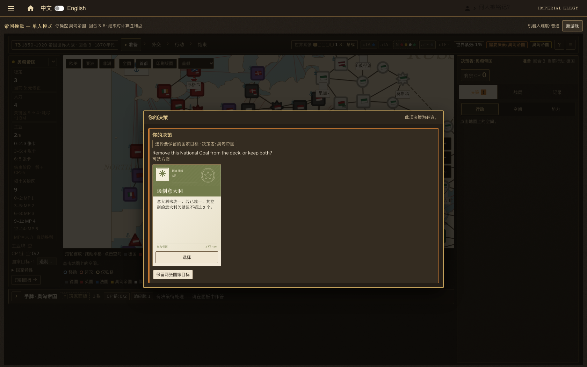
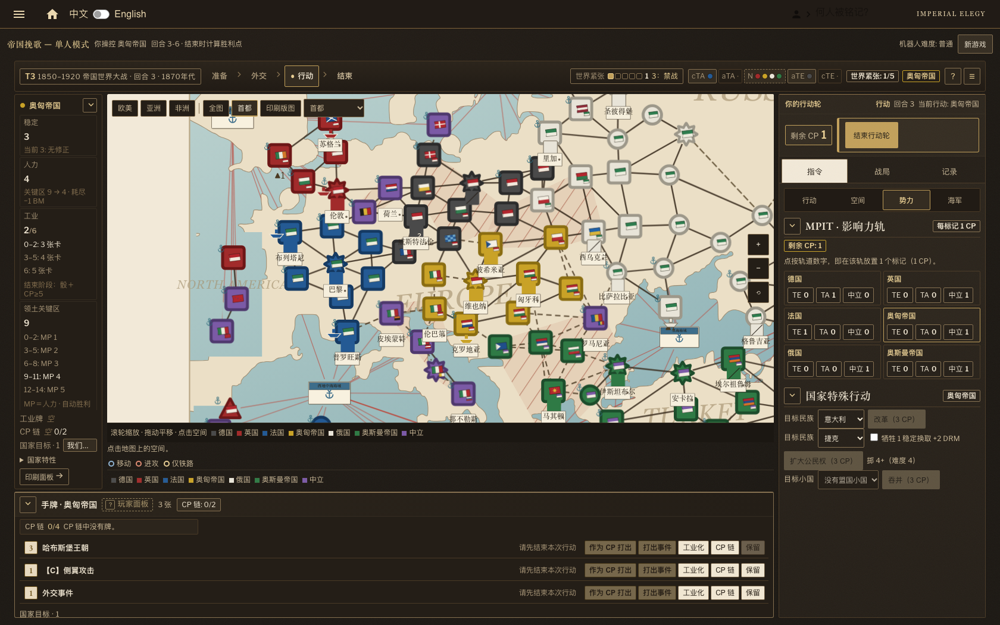
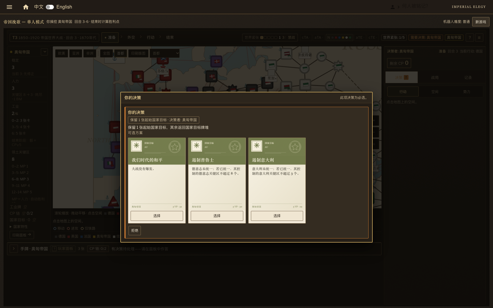
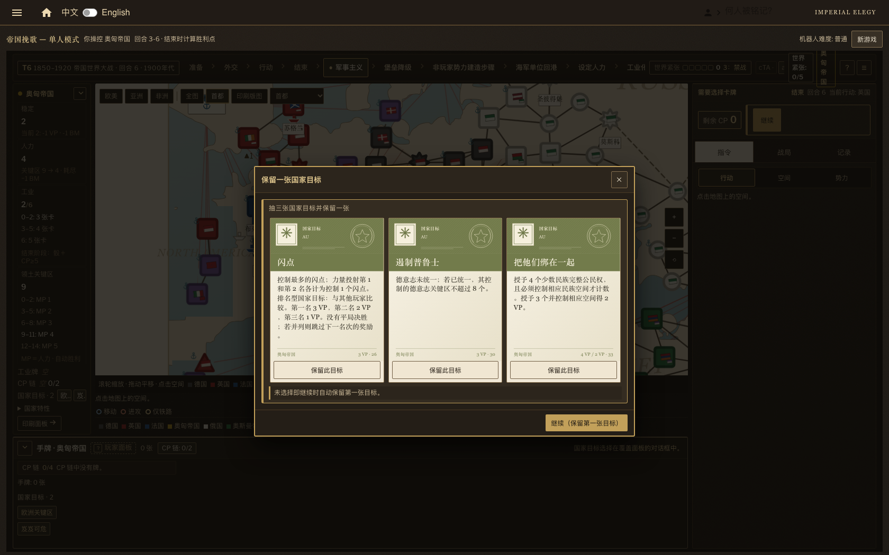
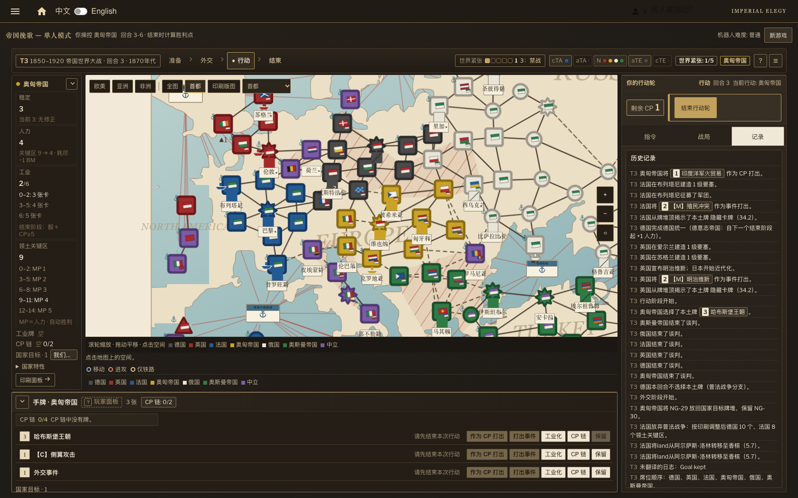

# 帝国挽歌（Imperial Elegy）单人模式 · 1870 剧本 · 奥匈帝国试玩与修复记录

日期：2026-11-23
入口：`http://127.0.0.1:5173/localIE/solo`（本地 Vite 开发服务器）
剧本：`1870 剧本`（第 3–6 回合：1870 年代 – 1900 年代，共 4 回合）
座位：P4 奥匈帝国（AU），机器人难度「普通」，其余五个席位由规则 34 机器人接管
界面：简体中文，Chromium 1680×1050
依据：只使用页面文本与 `IE_rule.pdf`（规则条款引文见 `rules-checklist.md`；未把 playbook、errata、实现文档当作规则依据）

## 1. 试玩范围与结论

- 从单人入口选奥匈帝国、1870 剧本、普通难度，**完整走完第 3–6 回合**（准备/外交/行动/结束），直到 1870 剧本的最后一回合结束，页面给出终局：`endOfTurn6`，胜者奥斯曼（OT）。
- 全程只用页面操作推进（自动脚本只负责点击与读公开状态），机器人席位自动行动；期间机器人之间发生过 4 场有限战争（宣战、战时机动、战斗、复员都跑过），奥匈在结束阶段处理了 20.1 军国主义、20.9 联盟结算、20.11 抽国家目标等步骤。
- **关于「到世界大战」**：本轮没有走到大战爆发。按规则这并非实现缺陷——`IE_rule.pdf` 23.0（p.44）规定「当世界紧张达到 5 时掷危机表」，而 1870 剧本起始世界紧张为 1（页面显示 `世界紧张 1/5`），每个结束阶段 20.10（p.41）再减 1；4 回合里本局最高只到 3（第 5–6 回合的事件把它抬到 3，随后结束阶段回落到 2）。在固定 4 回合的剧本里，只有同一回合内连续多个提升世界紧张的事件才会触发 5。因此本记录的终点是剧本结束；大战爆发/爆发步骤/25.5 记分等路径用引擎级用例单独验证（第 7 节），并在第 6 节说明限制。
- 在试玩路径上共确认 **12 个可修复问题**（4 个高、6 个中、2 个低）并已修复；另记录 **3 个本轮不修的发现**（均因超出「页面文本 + 规则书」可判定范围），以及问题 4 的一个残留限制（25.5 的保留选择被确定性自动化）。

## 2. 对局经过（第 3–6 回合，摘要）

| 回合 | 页面观察 |
| --- | --- |
| 3 准备 | 开局抽 3 张国家目标并「保留 1 张，其余返回牌堆」的必选决定（本次新增）；随后法国机器人处理普法战争认输决定；奥匈的 1870 剧本牌堆编辑（移除「遏制意大利/遏制普鲁士」之一，或保留两张）。 |
| 3 行动 | 奥匈按事件/CP 出牌；机器人之间出现有限战争（页面进入「战时」）；结束阶段 20.1 军国主义按座位依次作答，20.11 奥匈抽 3 保留 1。 |
| 4 | 世界紧张 1→2；机器人的战争与复员流程继续；结束阶段联盟结算/军国主义/人力超额等决策都能完成。 |
| 5 | 事件把世界紧张抬到 3；20.11 奥匈再次抽目标；机器人仍按规则 34 行动。 |
| 6 | 最后一回合；结束阶段后一回合标记推进，页面按 1870 剧本在回合 6 结束（不是战役的回合 7），给出终局计分（胜者 OT）。 |

全程浏览器控制台 `ERRORS []`；没有卡死、没有无效行动刷屏。

## 3. 问题与修复清单

> 严重度：高＝阻断规则或造成错误对局；中＝规则/信息明显缺失；低＝文案、易用性或一致性。

| # | 问题 | 严重度 | 修复 |
| --- | --- | --- | --- |
| 1 | 开局「抽 3 张国家目标保留 1 张」不是选择，且未保留的两张被永久丢弃（每名玩家目标牌堆从 8/9 张缩到 6/7 张） | 高 | 抽到的牌先挂在开局决定上；新增 `startingGoal` 必选决定，选定后把其余两张**放回**目标牌堆（2.4 / 20.11） |
| 2 | 单人模式没有把五个机器人席位告诉引擎（`G.bots` 为空），34.1 难度与 34.4.5 免费复员对机器人都不生效 | 高 | 单人页把「我选的大国以外五席」作为 `bots` 与难度写进 setup；引擎按 34.1/34.4.5 处理 |
| 3 | 34.1「机器人不随玩家抽国家目标，而是在游戏结束/大战开始时一次抽 3/4/5 张」未实现：机器人在 20.11 与玩家一起抽 | 高 | 20.11 跳过机器人；新增 `drawBotGoals`，在剧本结束与大战爆发记分前按难度发 3/4/5 张 |
| 4 | 25.5「大战过早爆发时，不足 3 张国家目标的玩家反复抽 3 留 1 直到 3 张」缺失 | 高 | 大战爆发记分前补齐到 3 张（见第 4 节说明选择如何自动化） |
| 5 | 奥匈 1870/1880 剧本的目标牌堆编辑语义反了：选择的是「保留」而不是「移除」，日志与实际不一致，选到已在手牌的目标时什么都不移除 | 中 | 选项改为「移除 X」并新增「保留两张」；只允许移除仍在牌堆里的候选；日志记录真正移除的牌 |
| 6 | 25.2.2 双方都中立时的大战阵营形成用常量 `G.seed`（恒为 0），结果固定为德法开战；单边为空时按座位顺序选目标 | 中 | 改为真实掷骰（`ctx.random.Die`），单边为空时同样掷骰选目标，并写日志 |
| 7 | 33.4「不稳定局势」的 +1 DRM 把已获完整公民权的民族也算作「有权利」的民族，与 33.4.1「完整公民权民族不再算少数民族」矛盾 | 中 | DRM 只统计尚未获得完整公民权的民族 |
| 8 | 20.11 抽国家目标前不洗牌（2.4/20.11 明确要求洗牌），第 5 回合的抽牌完全可预测 | 中 | 抽牌前洗国家目标牌堆 |
| 9 | 奥匈「扩大公民权」不显示本次需要的掷骰目标（3+，每个已有公民权民族 +1，牺牲稳定 -2 DRM），玩家要自己数 | 中 | 国家特殊行动面板显示「掷 X+（难度 Y）」/自动成功/无法成功 |
| 10 | 法国机器人处理普法战争认输决定时永远选第一个选项（认输），违反 34.3「机器人对 PAC 未列出的决定要掷骰」 | 中 | 该决定（以及 AU 目标牌堆编辑）按 34.3 掷骰选择 |
| 11 | 中文界面里民族名 `Slovaks` 未翻译 | 低 | 补充「斯洛伐克」中文标签 |
| 12 | 开局国家目标、目标牌堆编辑、普法战争认输这三个**必选**设置决定也显示通用的「拒绝」按钮，拒绝后只会重开同一决策 | 低 | 与 20.1 等必选决策一致，隐藏通用「拒绝」 |
| 13 | 普法战争认输的六步调整只实现了一部分（德国 +1 卡牌标记缺失、法国首回合少 1 张牌未生效、回合 4 的 -1 标记只写不读；注释引用了不存在的测试） | 中 | **未修**：这些数值只印在 playbook 的 1870 设置页，超出本轮「页面文本 + 规则书」的依据范围，见第 6 节 |
| 14 | 33.4「梅特涅的遗产」硬编码在第 1 回合，1870 剧本（首回合为第 3 回合）永远不会触发 | 中 | **未修**：规则书写的是「第 1 回合」，剧本如何改写没有规则书依据，见第 6 节 |
| 15 | 1870 剧本的意大利「已统一」状态没有被套用：意大利军团存在，但伦巴第等空间仍由各意大利小国控制；奥匈因此显示 9 个领土关键区（与剧本数据的 8 不一致） | 中 | **未修**：需要 playbook 的 1870 设置数据来定控制标记，见第 6 节 |

## 4. 修复详解

### 问题 1（高）开局国家目标抽牌破坏牌堆

- 规则依据：2.4（p.6）「players will shuffle their NG deck, draw three NG cards, keep one card, and return the other two to their NG deck」；20.11（p.41）同文，另有 Play Note「players start with 1 NG in the 1870 and 1880 scenarios」。
- 现象：开局只弹出一条日志 `goalDrawn {count:3, kept:NG-28}`，玩家没有选择；`state0.json` 显示奥匈 `goals=["NG-30"]` 而 `goalDeck.length=6`（9 张池子抽 3 张后应为 8 张），另外两张被永久丢弃，五个机器人同样。
- 修复：`engine/setup.ts` 把抽到的牌存入 `flags.startingGoalChoices`（不预设保留牌）；`moves.ts#openSetupDecisions` 新增 `startingGoal` 决定（每个非机器人座位按座位序，机器人按 34.1 不抽）；`engine/scenarioSetup.ts#resolveStartingGoal` 把选中的牌加入 `goals`、其余两张放回 `goalDeck` 并记录 `goalKept`。单人/热座都按规则询问。
- 验证：页面截图 `01-starting-goal-choice.png`（3 个候选、中文卡名）；`scenarioData.test.ts` 断言开局候选 = 2（GE）/3、答完后 `goals=1` 且牌堆从 6 回到 8；`botGoals.test.ts` 断言机器人开局 0 张。

### 问题 2（高）单人机器人席位没有告诉引擎

- 规则依据：34.1（p.56）难度决定机器人抽多少国家目标、也决定 34.4.5 的免费复员规模；页面文本（单人页）也写明「一个难度覆盖全部机器人席位…并决定机器人的免费复员规模」。
- 现象：`/localIE/solo/play` 创建对局时只传 `{scenario, noGw, botDifficulty}`；`window.__IE_STATE__.bots` 为 `[]`，引擎只把五个席位的客户端当普通玩家。`botFreeRedeployment` 因此永远跳过它们，难度只剩界面文字。
- 修复：`components/localSetup.ts` 新增 `soloSetupData()`，把 `soloBotSeats(power)` 的五个席位、剧本、难度一起写进 setup；`soloMatch.tsx` 用它创建对局（缓存键也带玩家席位，避免不同席位复用同一个 master）。
- 验证：`botGoals.test.ts`「solo match marks its five bot seats」断言 `G.bots` 为 GE/UK/FR/RU/OT 且难度传递；实际对局 `verify-setup-state.json` 中 `bots` 为这五席。

### 问题 3（高）34.1 机器人国家目标未实现

- 规则依据：34.1（p.56）「Bots do not draw NGs when player's draw NGs, instead bots draw all their NGs at the end of the game (if there has been no GW) or the start of the GW… Easy: 3, Normal: 4, Hard: 5」。
- 现象：20.11 的抽牌循环没有机器人判断，机器人与玩家一起在回合 3/5 抽目标；`botDifficultyOf` 除免费复员外没有任何消费点。
- 修复：新增 `engine/botGoals.ts`（`botGoalCount` / `drawBotGoals`）；`moves.ts#endPhaseDrawNgs` 跳过机器人；`greatWar.ts#outbreakGreatWar` 与 `victory.ts#finishScenario` 在记分前给机器人按难度发目标。日志记录 `botGoalsDrawn`。
- 验证：`botGoals.test.ts` 三条用例（难度 3/4/5、20.11 跳过机器人、剧本结束前发牌并计分）；本轮实际对局终局前日志出现 5 条 `botGoalsDrawn count:4 difficulty:normal`（普通难度）。

### 问题 4（高）25.5 大战爆发的国家目标补抽

- 规则依据：25.5（p.47）「If the GW occurs early… all players with less than 3 NGs draw 3 NGs and choose one to keep. They repeat this process until they have 3 NGs to score.」
- 现象：`greatWar.ts` 直接 `scoreGoals` 后清空目标，1870 剧本在大战第 3/4 回合爆发时玩家只有 1 张目标，会被只按 1 张计分。
- 修复：记分前对每个非机器人、目标不足 3 张的玩家循环「洗牌 → 抽 3 → 保留 1 → 其余放回」直到 3 张，日志 `outbreakGoalTopUp`。
- 限制：爆发步骤在单个 move 内同步执行，暂时无法中途挂起等待玩家点选，因此保留哪张用「最高印刷 VP」的确定性默认；牌数与记分已符合规则。彻底改为玩家选择需要把爆发步骤拆成可恢复流程（见第 6 节）。
- 验证：`botGoals.test.ts` 两条（每个玩家爆发后 3 条记分、补抽保留高 VP 牌）。

### 问题 5（中）奥匈目标牌堆编辑语义反转

- 规则依据：2.4（p.6）奥匈有 9 张国家目标，其中 1 张只用于 1870/1880 剧本；这两个剧本的印刷设置允许奥匈移除「遏制意大利」或「遏制普鲁士」之一。
- 现象：页面提示「Remove one of these National Goals from the deck?」，但 `resolveGoalChoice` 把选中的牌当成「保留」，删除另一张；日志还写反。更糟的是开局抽牌已经拿走一张候选时，删除目标是空操作，日志仍称已移除。
- 修复：`resolveGoalChoice` 改为「选择要移除的牌」，新增 `keep`（保留两张）选项；`openSetupDecisions` 只列出仍在牌堆中的候选，无候选时清掉标记；日志 `goalRemoved {goal, kept}` / `goalRemovalDeclined`。
- 验证：截图 `02-au-goal-deck-edit.png`（「移除『遏制意大利』/移除『遏制普鲁士』/保留两张国家目标」）；`scenarioData.test.ts` 两条用例（移除的是选中的牌、保留两张、手牌里的候选不能被移除）。

### 问题 6（中）25.2.2 大战阵营形成用常量种子

- 规则依据：25.2.2（p.46）「roll a die and use the following results: 1 – GE and FR go to war … 6 – AU and GE go to war」；单边为空时「roll a die to break a dispute」。
- 现象：`formAlliances` 用 `(G.seed % 6) + 1`，而 `G.seed` 在 setup 固定为 0（此后无人更新），所以永远 1 = 德法开战；单边为空时直接取座位序第一个中立国。
- 修复：改为 `die(ctx, 6)`；单边为空时在合格中立国中用骰子选目标；新增 `gwAllianceRoll` / `gwAllianceTarget` 公开日志。
- 验证：`gwAllianceFormation.test.ts`（骰 1 → GE/FR，骰 6 → GE/AU；单边为空时按骰选目标）。

### 问题 7（中）不稳定局势 DRM 多算完整公民权民族

- 规则依据：33.4（p.55）「Add a +1 DRM for each minority nationality with rights」；33.4.1（p.55）「a nationality with full citizenship is no longer considered a minority nationality to the AU player」。
- 现象：授予完整公民权时引擎同时把它写进 `rights`（保留权利收益），DRM 直接用 `rights.length`，于是每多一个公民权民族反而多 +1 DRM，方向与规则相反。
- 修复：DRM 统计 `rights` 中**不在** `citizenship` 里的民族。
- 验证：`characteristics.test.ts` 新增用例（2 个有权利、1 个已公民权 → DRM=1、总点 4）。

### 问题 8（中）20.11 抽国家目标不洗牌

- 规则依据：2.4 / 20.11（p.6、p.41）「shuffle their NG deck, draw three NG cards」。
- 现象：`endPhaseDrawNgs` 直接 `goalDeck.splice(0, n)`；`chooseGoal` 把未保留的牌追加到牌堆尾，导致后续抽牌完全确定。
- 修复：每名非机器人玩家抽牌前 `shuffle(ctx, goalDeck)`。
- 验证：`ngDrawShuffle.test.ts` 用固定骰 1 的确定性洗牌结果断言抽到的第一张不是牌堆第一张。

### 问题 9（中）扩大公民权的目标数不显示

- 规则依据：33.4.1（p.55）「roll ≥ 3 succeeds. Increase the difficulty of the roll by one for each nationality that already has citizenship. Before rolling, you may decrease your stability by 1 to apply a +2 DRM.」
- 现象：`canGrantCitizenship` 已算出 `difficulty` / `rollNeeded`，但 `NationalActionsPanel` 没有读取，玩家花 3 CP 前看不到目标；勾选牺牲稳定后数字也不更新。
- 修复：`useBoardModel` 把 `auCitizenRoll` 送进面板，在「扩大公民权」按钮旁显示「掷 X+（难度 Y）」/「自动成功」/「无法成功（需要大于 6）」，勾选牺牲稳定时实时变化。
- 验证：截图 `03-national-actions-citizenship-roll.png`（本局显示「掷 4+（难度 4）」，因为匈牙利已有完整公民权）。

### 问题 10（中）法国机器人永远认输普法战争

- 规则依据：34.3（p.56）「if a bot ever has to make a decision that isn't explicitly laid out on the bot PAC, roll a die to determine the result.」
- 现象：`botPendingMove` 的默认分支永远取 `options[0]`，而 `francoPrussianConcession` 的第一个选项是「认输」，于是每局单人都走认输分支（本轮日志 `francoPrussianConcession` 也证明如此）。
- 修复：`botPendingMove` 增加可选的 `ctx`，对 `francoPrussianConcession` / `scenarioGoalChoice` 两类 PAC 未列出的设置决定按 34.3 掷骰；`botDecision` 调用时传入 `ctx`。
- 验证：`bot.test.ts` 新增用例（骰 1 → concede，骰 2 → fight）。

### 问题 11（低）`Slovaks` 未翻译

- 规则依据：33.4.1（p.55）奥匈面板列出八个民族（民族名印在玩家面板上）。
- 现象：中文界面奥匈面板显示 `罗马尼亚 / Slovaks / 克罗地亚`；`NATIONALITY_LABELS_ZH` 缺 `Slovaks`。
- 修复：补 `Slovaks: "斯洛伐克"`（并顺手补 `Slovenes`）。
- 验证：截图 `03`/`04`；`nationality.test.ts` 遍历 `AU_NATIONALITIES` 断言中文标签存在。

### 问题 12（低）必选设置决定仍提供「拒绝」

- 规则依据：2.4 / 20.11 的开局抽牌必须保留 1 张；1870/1880 的目标牌堆编辑是印刷设置步骤；普法战争认输决定也必须二选一。它们都不是可放弃的可选窗口。
- 现象：新加的「保留 1 张起始国家目标」对话框底部有「拒绝」；点它不会推进决策，只会让同一个 pending 重新出现（第 5 节截图 `01` 的旧版本可见）。`scenarioGoalChoice` / `francoPrussianConcession` 同样。
- 修复：把这三个 kind 加入 `MANDATORY_PENDING_KINDS`，与 20.1/20.5/20.9/目标返还一致，只保留印刷选项；`组件/board.test.tsx` 新增用例断言无 `ie-pending-option-decline`。
- 验证：刷新后的截图 `01` 已无「拒绝」；`board.test.tsx` 52 个用例通过。

## 5. 已验证正常的部分

- 单人入口：六个大国、难度（简单/普通/困难）、1870 剧本与「回合 3-6 · 结束时计算胜利点」说明；选奥匈后只挂载自己的棋盘，`G.bots` 现在为其余五席。
- 1870 开局：回合 3 / 1870 年代；世界紧张 1；奥匈稳定 3、人力 3、工业 2、领土关键区 8（设置值）、国家目标 1 张（开局选择后）。
- 准备阶段的可选「随机弃 1 换 +1 稳定」；外交阶段的谈判结束与本土牌二选一；行动阶段一张牌一个行动轮、强制事件只能打出事件；结束阶段 20.1/20.5/20.9/20.11/20.12 顺序与决策都能完成。
- 20.11 只给奥匈（人类）抽目标，机器人不再在结束阶段抽（日志只有 1 条 `goalDrawn`，且在开局；终局前才有 5 条 `botGoalsDrawn`）。
- 1870 剧本在回合 6 结束时正确结束（`endOfTurn6`），而不是按战役跑到回合 7。
- 机器人对局中的有限战争、战斗、复员流程（4 场战争）可跑通，浏览器无控制台错误。

## 6. 未修复的发现与限制

1. **普法战争认输调整不完整（问题 13）**：德国 +1 卡牌标记未写、法国首回合少 1 张牌的逻辑是死代码、回合 4 的 -1 标记只记录不消费，且注释引用了不存在的 `scenarioSetup.test.ts`。这些数值只印在 `IE_playbook.pdf` 的 1870 设置页；同一文件还写着剧本设置以 playbook 为准，而本任务的依据被限定为页面文本与 `IE_rule.pdf`，因此本轮只记录不修改。修复它需要先确认印刷数值与实现口径。
2. **梅特涅的遗产在 1870 剧本不触发（问题 14）**：`moves.ts` / `characteristics.ts` 以 `G.turn === 1` 判定，而 1870 首回合是第 3 回合。规则书 33.4 只写「第 1 回合外交阶段结束」，没有说剧本如何重定基准，先记录。
3. **1870 剧本的意大利统一状态没有套用（问题 15）**：`constant/scenarios/s1870.ts` 标注 `italy.unified=true` 并放了意大利军团，但 `G.persistent.italyUnified` 未置位、意大利各小国仍存在、伦巴第仍由奥匈控制。于是奥匈在第 3 回合实际按 9 个领土关键区计算人力（页面「领土关键区 9」），与剧本数据里的 8 不一致。修复需要剧本印刷的控制标记/小国清单（playbook 数据），超出本轮依据范围。
4. **25.5 的「选择保留哪张」被自动化为最高 VP（问题 4 的限制）**：牌数与记分符合规则，但玩家没有实际选择；要完全符合规则需要把大战爆发步骤拆成可恢复的 pending 流程。
5. **大战爆发未在本轮 1870 剧本中发生**：世界紧张最高 3（起始 1，结束阶段 -1/回合），4 回合内没有触发 23.0。大战爆发、25.5 记分、26.x 计划/机动等由既有 `greatWar*` 测试与新增 `botGoals`/`gwAllianceFormation` 用例覆盖；如果需要页面级的大战验证，建议单独用「历史大战剧本」或战役跑到世界紧张 5。

## 7. 本地验证

- `npx tsc --noEmit --pretty false`：通过。
- 新增/更新的 Jest 用例：
  - `botGoals.test.ts`（7）：单人机器人席位、34.1 难度发牌、20.11 跳过机器人、剧本结束发牌、25.5 补抽。
  - `gwAllianceFormation.test.ts`（2）：25.2.2 掷骰与单边为空选目标。
  - `ngDrawShuffle.test.ts`（1）：20.11 抽牌前洗牌。
  - `nationality.test.ts`：八个民族的其中文标签。
  - `characteristics.test.ts`：完整公民权不再加不稳定 DRM。
  - `bot.test.ts`：34.3 对普法战争认输决定掷骰。
  - `scenarioData.test.ts`：开局抽 3 保留 1 返回 2、目标牌堆编辑的移除语义、开局决定顺序。
- 相关套件（本机轻量运行，CI 会跑全量）：`scenarioData`、`scenarioPlaythrough`、`setup`、`endPhaseSteps`、`endPhaseResiduals`、`victory`、`hotseatRuleAudit`、`migrations`、`saveMigration`、`multiplayerBots`、`selfPlayRegression`、`botSelfPlay`、`greatWarFlow`、`greatWarIntegration`、`greatWarStability`、`gwAllianceFormation`、`botGoals`、`ngDrawShuffle`、`bot`、`nationality`、`characteristics`、`localSetup`、`components/board`、`components/playerMat`，全部通过。
- 浏览器复跑：单人 1870 奥匈全程无控制台错误（`ERRORS []`），终局 `endOfTurn6`。

## 8. 复现要点

1. `yarn start` 后打开 `/localIE/solo`，选「P4 奥匈帝国」+「1870 剧本」+「普通」，点「开始单人游戏」。
2. 准备阶段会弹出「保留 1 张起始国家目标」：三张候选，选定后其余两张回到目标牌堆（截图 `01`）。
3. 随后是奥匈的目标牌堆编辑：移除「遏制意大利」/「遏制普鲁士」/保留两张（截图 `02`）。
4. 进入奥匈行动轮后切到右侧「势力」页：八个民族名均为中文（含「斯洛伐克」），「扩大公民权」旁显示「掷 X+（难度 Y）」（截图 `03`、`04`）。
5. 结束时 1870 剧本在回合 6 结束并计分（截图 `05`）；「记录」页可看到开局 `goalKept`、目标移除与终局前的 `botGoalsDrawn`（截图 `06`）。

## 截图索引

