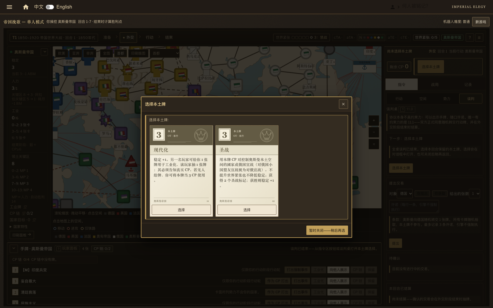
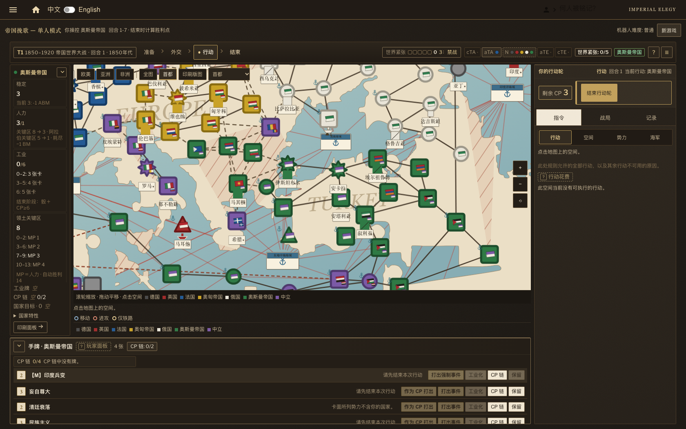
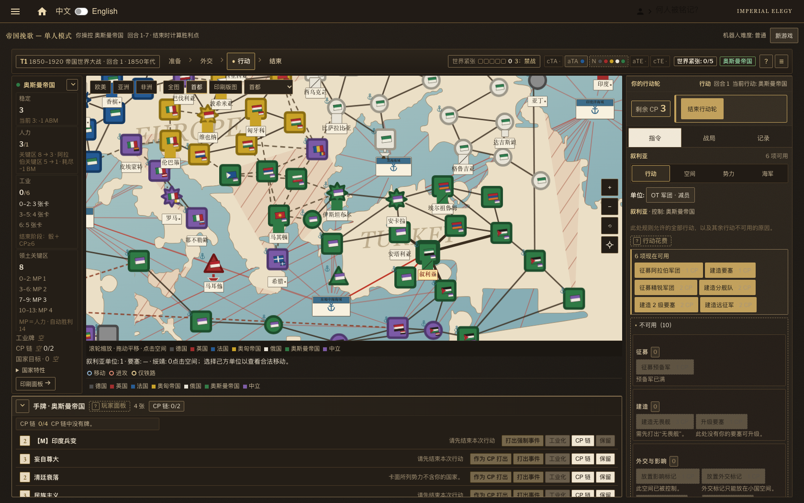
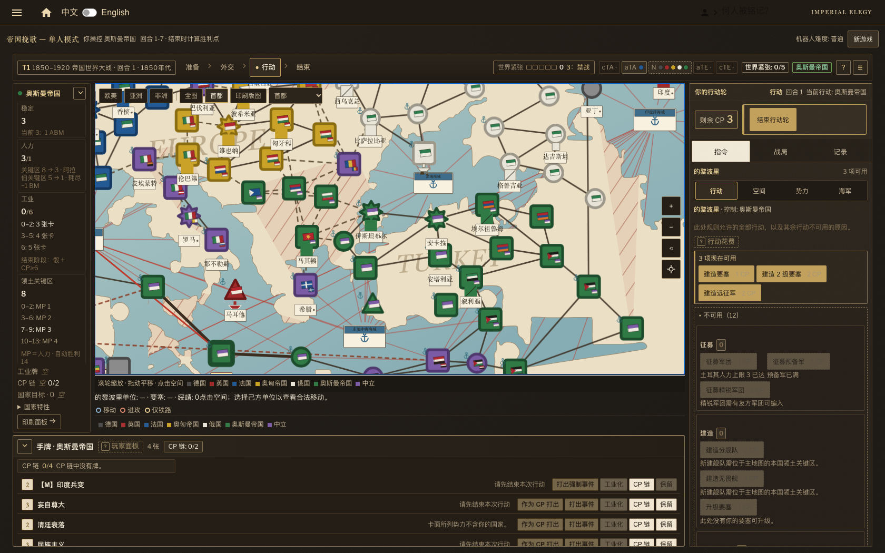

# 帝国挽歌（Imperial Elegy）单人模式 · 奥斯曼试玩记录

日期：2026-11-23
入口：`http://127.0.0.1:5173/localIE/solo`（本地 Vite 开发服务器）
剧本：`1850–1920 战役`（第 1 回合，1850 年代）
座位：P6 奥斯曼帝国（OT），机器人难度「普通」，其余五个席位为规则 34 机器人
界面：简体中文，Chromium 1680×1050
依据：只使用页面文本与 `IE_rule.pdf`（未参考 playbook、errata 或实现文档）

## 1. 试玩范围

- 从单人入口选奥斯曼帝国、1850–1920 战役、普通难度，进入第 1 回合。
- 完成准备阶段、外交阶段（谈判、本土牌二选一），进入奥斯曼自己的行动轮。
- 在行动轮打出本土牌「现代化」的 3 CP，逐项查看伊斯坦布尔、叙利亚、阿拉伯、的黎波里、突尼斯、开罗等空间的行动列表与不可用原因。
- 期间机器人俄国对奥斯曼发动有限战争，页面进入战时流程；未走完整个战争与回合结束，记录的是可复核的第 1 回合片段。
- 截图见本目录 `01`–`05`；自动化脚本只负责点击和读取公开状态，规则判断均来自页面文字与 `IE_rule.pdf`。

## 2. 问题与修复

> 严重度：高＝规则被阻断或产生错误对局；中＝规则/信息明显缺失；低＝文案、易用性或一致性。

| # | 问题 | 严重度 | 修复 |
| --- | --- | --- | --- |
| 1 | 阿拉伯军团无法从界面或机器人建造 | 高 | 界面与机器人按空间推导土耳其/阿拉伯类型，并把类型传给征募行动 |
| 2 | 要塞被错误限制在「欧洲」，北非主地图空间不能建要塞 | 中 | 界面与引擎改用 `submap === "main"`（规则 12.12「main map」） |
| 3 | 北非主地图的军团堆叠上限被算成 2，而非 3 | 中 | `landStackingLimit` 与部署余量改用主地图判断 |
| 4 | 的黎波里/突尼斯即使有陆上交通线也不能建造舰队 | 中 | 使用按势力计算的领土关键区，并同时检查 33.6 的陆上 LoC |
| 5 | 单人机器人提前提交本土牌，控制台反复报 `invalid move: pileHomeCard` | 中 | 谈判未全部结束前让机器人等待，不再提交会被引擎拒绝的行动 |
| 6 | 中文本土牌选择框仍显示「English text」折叠条 | 低 | 选择框的卡面不再渲染英文译文折叠条 |

### 问题 1（高）阿拉伯军团无法建造

- 规则依据：`IE_rule.pdf` 12.2「The Ottomans have two different types of armies: Turkish armies must be built in spaces that do not contain a minority nationality, while Arab armies can only be built in spaces with Arab nationality.」；33.6「OT tracks Arab and Turkish manpower separately.」
- 现象：在叙利亚（Arab 关键区）与阿拉伯，行动列表里只有一条「征募军团」，原因是「地方自治：土耳其军团不能建在阿拉伯／埃及关键区」或「土耳其人力上限 3 已达」。没有「征募阿拉伯军团」，阿拉伯人力 1 从未被使用。机器人同样按土耳其默认值检查，因此也不会在阿拉伯关键区征募。
- 影响：奥斯曼的阿拉伯军团与阿拉伯人力（33.6）在实战中不可用；叙利亚的减员阿拉伯军团也无法补员。
- 修复：`components/actionAvailability.ts` 用 `ottomanArmyTypeFor(space)` 推导类型后调用 `canRecruitIn`，把 `{ottoman}` 传给 `moves.recruit`，并在阿拉伯空间把行文改为「征募阿拉伯军团」；`engine/bot.ts` 的 `botRecruitSpace` 做同样推导。
- 验证：叙利亚现在显示可用的「征募阿拉伯军团 · 1 CP」（减员补员）；阿拉伯在阿拉伯人力已满时显示「阿拉伯人力上限 1 已达」，而不是土耳其规则。截图 `04-syria-arab-army-row.png`。新增 `ottomanRecruitmentUi.test.ts` 锁定行文、启用状态与传给引擎的参数。

### 问题 2（中）要塞只能在欧洲建造

- 规则依据：`IE_rule.pdf` 12.12「Forts can only be built on the main map (exception: the Indian fort)」。
- 现象：在奥斯曼控制的的黎波里、突尼斯（北非，主地图），「建造要塞」「建造 2 级要塞」均被禁用，原因写「要塞只能在欧洲建造」；而亚洲的叙利亚、阿拉伯反而可以建。界面和 `buildFort` 都用了 `region === "europe"`，把「主地图」误当成「欧洲」。
- 影响：北非主地图上的要塞行动不可用，亚洲主地图的判断则只是碰巧通过。
- 修复：`moves.buildFort` 与 `components/actionAvailability.ts` 改为 `SPACES[space]?.submap !== "main"`，文案改为「要塞只能在主地图建造」。
- 验证：的黎波里现在可用「建造要塞 · 1 CP」「建造 2 级要塞 · 2 CP」；加拿大等殖民子地图仍拒绝。截图 `05-tripoli-fort-rows.png`；`fortConstruction.test.ts` 新增两条用例。

### 问题 3（中）北非主地图堆叠上限错误

- 规则依据：`IE_rule.pdf` 5.5.1「Land spaces on the main map can hold 3 armies, all other land spaces can hold 2 armies. Exception: all Ottoman home spaces (including those in Europe) can hold 2 armies.」
- 现象：`landStackingLimit` 用 `region === "europe" ? 3 : 2`，于是阿尔及利亚、埃及等北非主地图空间被当成「其他地方」只能放 2 个军团；部署预备军的界面余量也用了同一错误判断。
- 影响：主地图上的非欧洲空间少一个堆叠位，影响征募、部署和 5.5.3 超额损失。
- 修复：`engine/rules.ts#landStackingLimit` 改为 `submap === "main" ? 3 : 2`，奥斯曼核心领土的 2 例外仍优先；`components/useBoardModel.ts` 的部署余量改为调用同一个函数，避免两套算法。
- 验证：`overstacking.test.ts` 新增阿尔及利亚=3、加拿大=2、埃及/的黎波里=2 的断言。

### 问题 4（中）的黎波里/突尼斯有陆上 LoC 也不能建造舰队

- 规则依据：12.4「Newly built fleets must be placed in a controlled, territorial home key on the main map with a port.」；33.6「Tunisia and Tripoli neither count as keys nor for power projection unless OT can trace a LoC to the keys by land.」
- 现象：的黎波里、突尼斯是有港口的主地图奥斯曼核心领土，但页面一直显示「新建舰队需位于主地图的本国领土关键区」。原因是它们印刷时没有 `keyType`，而界面和引擎用 `effectiveKeyType` 判断；即使 33.6 的陆上 LoC 成立、它们已经算作领土关键区，这个判断仍然返回 `undefined`。
- 影响：奥斯曼无法利用北非港口建造舰队；该限制在获得陆上 LoC 后仍不解除。
- 修复：在 `engine/rules.ts` 增加 `isTerritorialKeyForPower`：先看按势力计算的 `keyTypeForPower`，再对奥斯曼的的黎波里/突尼斯检查 `hasOtAutonomyLandLoc`；`moves.constructFleet` 与行动列表共用这个判断。
- 验证：`navalConstruction.test.ts` 新增用例——开局无陆上 LoC 时拒绝，埃及与大沙海归奥斯曼后允许，并扣除 2 CP。由于界面需要实际打出陆上通路，本项以引擎级用例验证。

### 问题 5（中）机器人提前提交本土牌

- 规则依据：9.1 外交阶段先完成谈判，再选择本土牌；34.2 机器人把随机本土牌加入牌堆。
- 现象：进入外交阶段后，控制台在人类尚未结束谈判时反复出现 `invalid move: pileHomeCard`。`SoloBotSeat` 在机器人自己的谈判段结束后就提交 `pileHomeCard`，但引擎要求全桌谈判结束（`negotiationConcluded`）才接受。
- 影响：单人页面出现无效行动日志；如果人类迟迟不结束谈判，机器人会反复重试，最坏情况下走 3 次失败后的兜底 `endDiplomacy`（同样会被拒绝）。
- 修复：`components/soloBots.tsx` 在谈判尚未全部结束时让已结束自己段落的机器人等待（`parkedUntilNegotiationCloses`），与在线 driver 的 `botSeatToAct` 行为一致。
- 验证：重跑同一路径，浏览器控制台无错误（`ERRORS []`）。

### 问题 6（低）中文本土牌选择框里的「English text」

- 现象：中文界面的本土牌选择弹窗在每张卡面下都有一个「English text」折叠条，点开后显示英文原文；同页其余文字都是中文。
- 影响：与项目既定的「卡面只印当前语言」不一致，中文玩家会看到无必要的英文切换项。
- 修复：`components/CardChoice.tsx` 渲染 `CardFace` 时传 `showTranslation={false}`；卡牌检查器（CardInspector）保留原有的「英文原图」按钮。
- 验证：截图 `02-home-card-choice.png` 中不再出现「English text」。

## 3. 已验证正常的部分

- 单人入口正确显示六个大国、规则 34.1 的简单/普通/困难三档，以及剧本选择；选奥斯曼后只挂载奥斯曼一个棋盘。
- 准备阶段手牌 4 张（工业 0 的 3 张 + 稳定 3 的 1 张），可选的「随机弃 1 张换 +1 稳定」按可选样式出现。
- 外交阶段谈判、结束谈判、本土牌二选一的顺序正确；本土牌「现代化」「圣战」都显示中文卡面，选择后加入手牌。
- 奥斯曼玩家面板显示稳定 3、土耳其/阿拉伯人力 3/1、领土关键区 8、阿拉伯关键区 5、工业 0、预备军 0/0，与 33.6 和开局设置一致。
- 工业 0 时每回合 3 张牌；「现代化」可作 3 CP 打出，第二次点击确认后 CP 正确变为 3。
- 叙利亚的减员阿拉伯军团可通过「征募阿拉伯军团」补员；阿拉伯在人力满时给出阿拉伯人力上限。
- 的黎波里的要塞行动、奥斯曼各主地图空间的分舰队/远征军行文与规则一致（舰队仍受 33.6 陆上 LoC 限制）。

## 4. 未覆盖 / 限制

- 本次推进到第 1 回合奥斯曼行动轮，未走完整个行动阶段、战争结算、结束阶段与最终计分。
- 大战、圣战标记的使用与移除、29.2 殖民战争中的奥斯曼修正未在本次页面操作中覆盖。
- 问题 4 的界面路径需要先在局内建立陆上 LoC，未在本次单局中构造；以引擎用例验证。
- 机器人难度对 34.1 国家目标数量、34.4.5 复员规模的影响未在本次对局中逐一核对。

## 5. 本地验证

- `npx tsc --noEmit --pretty false`：通过。
- 相关 Jest：`fortConstruction`、`navalConstruction`、`overstacking`、`ottomanRecruitmentUi`、`characteristics`、`characteristicsLive`、`otAutonomyKeys`、`bot`、`botSelfPlay`、`hotseatRuleAudit`、`boardActions`、`board`，共 239 个用例通过；另跑 `cardChoiceModal` 57 个用例通过。
- 浏览器复跑：单人奥斯曼路径无控制台错误。

## 截图索引

